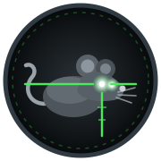

<div align="center">



# NIGHT SHIFT — Rat Sniper

**360° 850nm infrared night-vision farmyard rat sniper — built for the web, mobile, and [dotframe](https://dotframe.crafter.games).**

[](https://rat-sniper.crafter.games)
[](https://dotframe.crafter.games)
[](LICENSE)

</div>

---

Track glowing white tapetum-lucidum eyeshine along concrete barn seams, hold your breath to steady the inverted-T green reticle, compensate for `.22` PCP pellet drop, and clear the yard across a seamless 360° night-vision panorama.

## Highlights

- **Seamless 360° Cylindrical Farmyard** — Spin infinitely left or right through three connected barn zones (**North Barn Wall**, **South Corrugated Doorway**, **West Timber Feed Rack**) with a live compass tape (`000°–359°`).
- **Authentic 850nm Digital IR Optics** — Monochrome IR spotlight falloff, live CMOS sensor grain, toggleable IR torch (`HI`/`LO`), glowing directional eyeshine, and the classic green inverted-T reticle.
- **Tactile `.22` PCP Ballistics** — Scoped rifle inertia, figure-8 breathing sway with breath-hold stamina & heartbeat audio, `2.0x / 4.0x / 8.0x` zoom, 8-pellet rotary magazine with bolt-cycle timing, IR-reflected pellet tracer arc, and recoil kick.
- **Spatiotemporal Rat Ecology** — Rats emerge smoothly from real burrows and doorways, sniff spilled grain, freeze with twin glowing eyes when startled by a miss, and duck back into cover without popping in or out of thin air.
- **Desktop & Mobile First** — Pointer Lock 360° aiming on desktop; 1-finger 360° touch drag + multi-touch **FIRE / ZOOM / BREATH / RELOAD / IR** controls on phones and tablets.
- **Procedural Web Audio** — Zero external audio files; suppressed PCP air-rifle shots, bolt cycling, rotary mag reloads, distinct rat / concrete / dirt / plastic-jug impacts, and night crickets synthesized live.
- **dotframe Native** — Ships with `dotframe.json` and a deterministic 60Hz `sim.ts` (`defineSim`) ready for headless simulation and replays.

## Controls

| Action | Desktop | Mobile |
|---|---|---|
| 360° Aim | Mouse (Pointer Lock) | Drag anywhere |
| Fire `.22` Pellet | `Left Click` | `FIRE` button |
| Optical Zoom (`2x / 4x / 8x`) | `Right Click` / `Scroll` | `ZOOM` button |
| Hold Breath | `Shift` / `Space` | Hold `BREATH` |
| Reload 8-rd Rotary Mag | `R` | `RELOAD` button |
| IR Illuminator (`HI / LO`) | `F` | `IR` button |
| Slew to Zone | `1` / `2` / `3` | Drag 360° |
| Toggle Scope Telemetry | `H` | — |

## Quick Start

```bash
git clone https://github.com/crafter-games/rat-sniper.git
cd rat-sniper
bun install
bun run dev
```

Open `http://localhost:3456`.

### Build & Verify

```bash
bun run build       # bundles hashed dist/web for Vercel
bun run typecheck   # TypeScript verification
```

## Made with dotframe

<a href="https://dotframe.crafter.games">
  <picture>
    <source media="(prefers-color-scheme: dark)" srcset="https://raw.githubusercontent.com/crafter-games/dotframe/main/assets/badge/made-with-dotframe-dark.svg">
    
  </picture>
</a>

## License

MIT — [Crafter Station](https://github.com/crafter-games)
